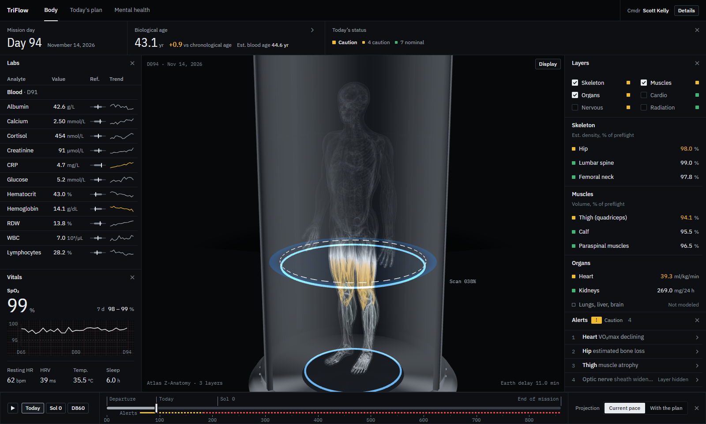
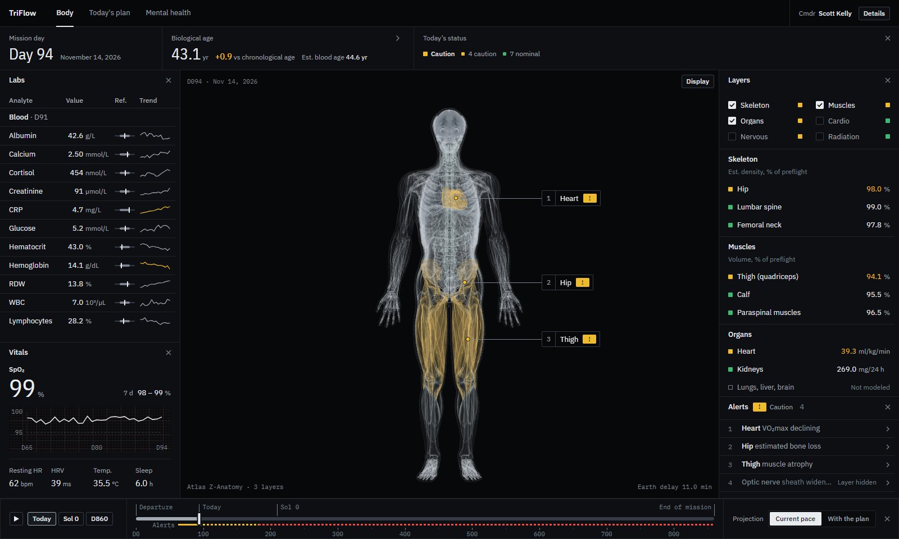
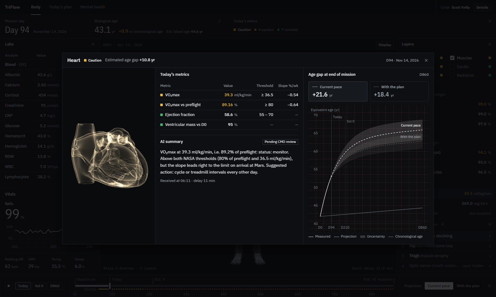
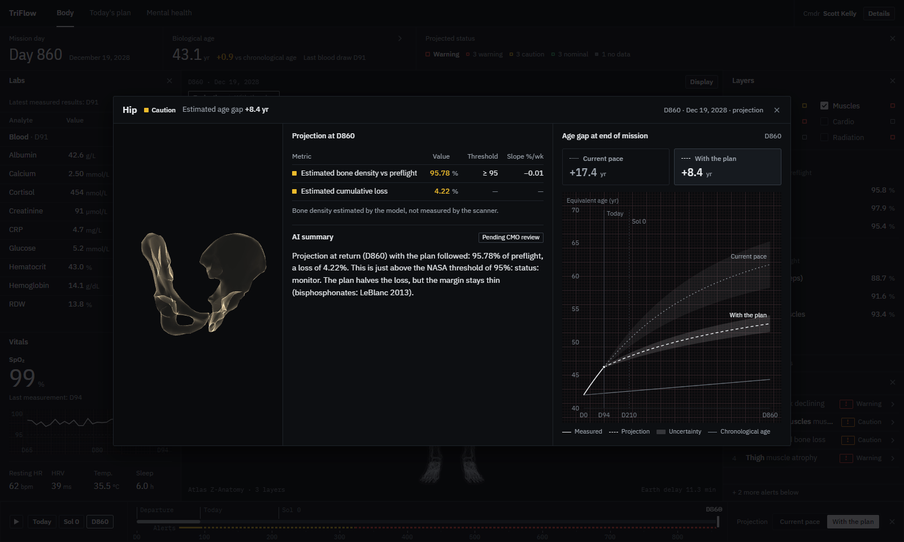
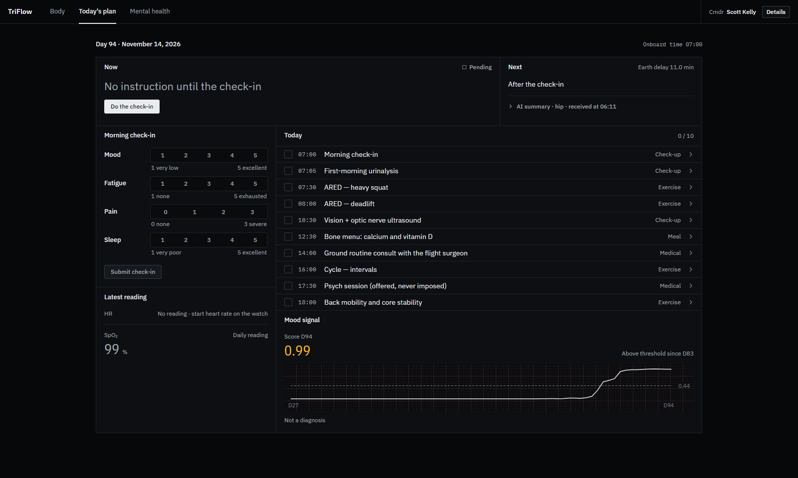
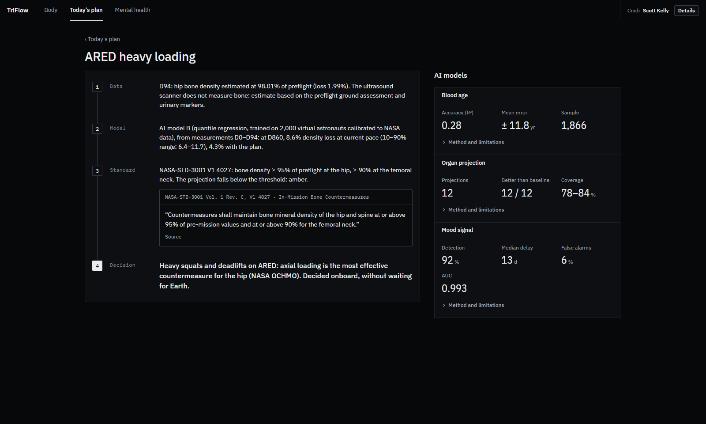
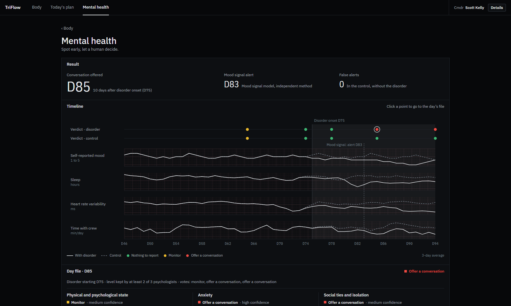

# TriFlow

**Crew health monitoring for long-duration space missions.** Every morning, the astronaut knows how their body is doing, what to do today, and why, without waiting for Earth.

*NASA Space Apps Challenge 2026 · Health Monitoring Software for Astronauts · Team TSP2k29*

| | |
| :-- | :-- |
| **▶ Try the app** | **[triflow-delta.vercel.app](https://triflow-delta.vercel.app)** — runs in the browser, best on a desktop screen |
| **▶ Pitch deck** | **[Animated slides](https://triflow-delta.vercel.app/slides/)** (arrow keys to navigate, **F** for full screen) · **[PDF](docs/pitch/TriFlow-demo-slides.pdf)** |
| **Built with** | React 19 · TypeScript · Three.js · Python (pandas, NumPy, scikit-learn) · Vercel · SwiftUI (Apple Watch) |



> The demo follows **Commander Scott Kelly** on a fictional 860-day mission to Mars, at **day 94**: the longest and most isolated case, with an 11-minute radio delay to Earth.
> All of his health data is **simulated**. Thresholds come from **NASA-STD-3001**, and every number on screen shows where it comes from.

---

## What it does

### Body: the whole body at a glance
A 3D anatomical body, built from layers (skeleton, muscles, organs, cardio, nervous, radiation). Each organ to watch is highlighted in the color of its status and anchored to the rule that triggered it.



- **Status colors come from written rules**, never straight from a model:
  - NASA-STD-3001 thresholds, such as V1 4027 for bone density or V1 4002/4003 for aerobic capacity;
  - team rules, such as the 7-day trend for muscle, with the rule named next to the organ.
- **Labs and vitals**: blood markers with their reference range and trend, plus SpO₂, resting heart rate, HRV, temperature and sleep.
- **Biological age**: PhenoAge from the blood panel, plus an estimated age gap per organ.

### Organ window: metrics, AI summary and projection
Double-click an organ to open its window: today's metrics against their thresholds, an AI summary that waits for the Crew Medical Officer, and the projection to the end of the mission.



### Timeline: current pace vs. following the plan
Move from today to **Sol 0** (arrival on Mars, day 210) and to the **return** (day 860). Switch between *Current pace* and *With the plan* to see the body change.
Following the plan every day halves the projected hip bone loss at return: **4.2% instead of 8.7%**.



### Today's plan: what to do, and why
A morning check-in (mood, fatigue, pain, sleep) sets the day's level. The plan lists exercises, meals, tests and consultations. Every task has a **Why** link, and the live heart rate comes from an Apple Watch.



### Reasoning: from the data to the NASA standard
Each decision is a short chain: data → model → standard (quoted verbatim) → decision. Model cards show each model's accuracy and limits.



### Mental health: spot early, let a human decide
A mood signal compares the astronaut with **their own baseline**, never with a population norm. A panel of AI agents reads the day's (synthetic) logs. The system **offers** a conversation with a human psychologist and never imposes one.



---

## The models

Three small machine learning models, trained offline in Python (pandas, NumPy, scikit-learn), exported as JSON and run in the browser.
**Models predict, NASA standards decide.**

| Model | Method | Training data | Test-set results |
|---|---|---|---|
| **Organ projection** (bone, muscle, heart) | Linear quantile regression, 10 / 50 / 90% | 2,000 virtual astronauts calibrated on published NASA data (simulated) | The 10–90% range holds 78–84% of the time; beats the no-ML baseline on 12/12 projections |
| **Blood age** | ElasticNet regression, 13 blood markers | 9,326 real adults, NHANES 2015–2018 (CDC) | R² 0.28, mean error ± 11.8 years. Tracks the change within one person, not the absolute value |
| **Mood signal** | Logistic regression on deviations from the personal baseline | 1,500 virtual astronauts × 151 days (simulated) | AUC 0.993, 92% of episodes detected, median delay 13 days, 6% false alarms |

Organ and mood models are trained on **simulated** cohorts: they show that the method works, not that it is clinically validated. Real astronaut data would be needed for that.

## Data honesty
- **Everything about the astronaut is simulated.** Scott Kelly is the starting point of the story; his real medical data is not used and is not public.
- Every number carries its source: a **NASA-STD-3001** rule, a **published** study, the **persona**, or a team **hypothesis** (labeled "Hypothesis"). The **Details** button shows where each figure comes from.
- The ultrasound scanner does **not** measure bone: bone density is **estimated** by a model, and the screen says so.
- Unknown means grey, never green by default. "Live" only appears for a fresh measurement.

## Apple Watch
A native Apple Watch + iPhone app (SwiftUI, folder [`watch/`](watch/), build instructions in [`watch/README.md`](watch/README.md)) sends the **real** heart rate to TriFlow, in near real time. It also shows the day's summary and the to-do list, and syncs ticks both ways.
The app talks to the TriFlow API: `POST /ingest`, `GET /api/watch/summary`, `/api/todo`, and real-time updates over Server-Sent Events (`GET /api/events`).

---

## Run it locally

Requires Node.js 20.19 or later.

```bash
npm ci
npm run dev        # http://localhost:5173 (add -- --host to reach it from a phone or watch)
npm test           # vitest
npm run build      # type-check + production build (site in dist/, API bundle in server/vercel/dist/)
```

Routes: `/body` · `/warroom` (Today's plan) · `/mental` · `/reasoning/:id`.
The pitch deck is served at `/slides/index.html`.
Useful URL options on `/body`: `?noscan=1` skips the scan animation; `?day=860&plan=1` opens the return day with the plan.

In development, the watch API runs inside the Vite dev server (in memory). On Vercel, it runs as a Node function (`api/index.ts`) backed by Upstash Redis; see `vercel.json`.

## Tech stack
React 19 · TypeScript · Vite · Three.js / React Three Fiber · Zustand · Vitest · Python: pandas, NumPy and scikit-learn (offline training on NHANES and simulated cohorts) · Vercel + Upstash Redis · SwiftUI (watch).

## Project structure

| Folder | Contents |
| :-- | :-- |
| `src/pages/` | Body, Today's plan (`warroom/`), Reasoning, Mental health |
| `src/three/` | 3D scene: anatomical body, scanner animation, organ viewer |
| `src/models/` | Triage, alerts, daily plan, reasoning chains, biological age, ML inference |
| `src/sim/`, `src/mocks/` | Simulated persona data, day 0 → 860 |
| `src/ingest/` | Check-in, Apple Health import, live measurements, real-time sync |
| `src/content/` | Exercises, meals, tests, NASA standards and references |
| `src/ui/` | Design system (`tokens.ts` is the single source of colors and type) |
| `server/`, `api/` | Watch API: local Vite plugin and Vercel function |
| `watch/` | Native Apple Watch + iPhone app (SwiftUI, XcodeGen) |
| `scripts/ml/` | Model training (Python) |
| `scripts/mental-agents/` | Multi-agent mental-health analysis, precomputed with Claude |
| `public/data/` | Simulated data, model cards, NASA standards, AI summaries |
| `public/models/` | 3D anatomy models (glTF) |
| `public/slides/` | Pitch deck (HTML, served at `/slides/`) |
| `tests/` | Tests |
| `docs/` | Screenshots, pitch PDF, NASA sources, and the team's hackathon notes (`docs/hackathon/`: roadmap, daily status, UI proposals, pitch scripts) |

## Team TSP2k29
- **Walid**: Body page, 3D scene, design system, integration.
- **Ahmed**: Today's plan, Reasoning, Apple Watch app and API, deployment.
- **Mouad**: simulated data, models, rules, UI design.
- **Steve**: 3D assets, science and sources, content, pitch.

## Credits
- **3D anatomy** (`public/models/*.glb`, **modified**: split per organ, simplified, meshopt-compressed), derived from the glTF export of [nqwrc/3d-anatomy](https://github.com/nqwrc/3d-anatomy), distributed under **CC BY-NC-SA 4.0**, **non-commercial use only**. Sources:
  - Z-Anatomy, The open source atlas of anatomy (CC BY-SA 4.0);
  - BodyParts3D, The Database Center for Life Science (CC BY-SA 2.1 Japan);
  - Cranial Nerves and Foramina, University of Dundee, CAHID (CC BY 4.0);
  - Anatomy of the Inner Ear, University of Dundee School of Medicine (CC BY-NC-SA 4.0);
  - Kidney, lissiecowley (CC BY-NC 4.0);
  - Brainder and White matter, University of Washington.
  - Details: [`public/models/CREDITS.md`](public/models/CREDITS.md).
- **Standards**: NASA-STD-3001 Vol. 1 Rev. C. **Ephemerides** (Earth–Mars delay): NASA JPL Horizons.
- **Blood data**: NHANES 2015–2018, CDC. **Biological age**: PhenoAge, Levine et al., *Aging*, 2018.

TriFlow is a hackathon prototype, **not a medical device**.
